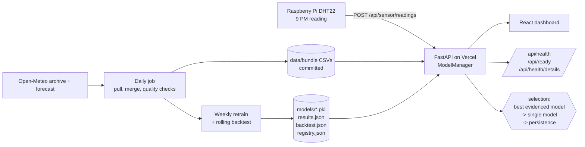

# ThermoSense: system design

Status legend: **live** = on `main` and deployed, **draft** = built on an open draft PR, awaiting the owner's word, **planned** = designed, not built.

## Problem

Cooling is slightly more than 10% of India's annual electricity demand and, on hot summer nights, air conditioners can drive as much as one-third of consumption; the summer peak load falls around 8 PM (IEA, [India's electricity demand grows at night](https://www.iea.org/commentaries/india-s-electricity-demand-grows-at-night-managing-rising-cooling-demand), 3 June 2026). Whether a household runs the AC or opens a window depends on the temperature at its own street around 9 PM. ThermoSense measures that number at one station and keeps score of how well forecasts predict it.

## Goals and non-goals

- Goal: an honest, evaluated forecast of the 9 PM temperature for one station, 1-3 days ahead, with intervals that actually cover.
- Goal: every claim on the site traceable to a measurement or an evaluation.
- Non-goal: a general weather service. One station is a thin dataset; the design is honest about that rather than hiding it.
- Non-goal: real-time streaming. The target is one daily value, so batch is the right shape.

## Architecture

Components and status:

| Piece | What it does | Status |
|---|---|---|
| Ingestion route | Validates and stores sensor readings; reference actuals are tagged `open_meteo_reference` and never counted as sensor data | live (storage is ephemeral on Vercel) |
| Bundle CSVs | `data/bundle/*.csv` is the serving copy of the dataset, because Vercel's bundler drops files under gitignored directories | live |
| Models | SARIMA, LightGBM, ensemble; one artifact per horizon | live (LightGBM cannot load on Vercel, so SARIMA serves there) |
| Selection | Best model by held-out day-1 RMSE, ignoring any model with fewer than 7 evaluated days; ensemble only if every base model loaded | live |
| Rolling-origin backtest | 6 expanding-window folds vs persistence, seasonal-naive and climatology baselines | draft (#30) |
| Conformal intervals | Calibrated 90% bands with walk-forward coverage | draft (#31) |
| Model registry | Versioned artifacts, data hash, backtest score, enforced promotion rule | draft (#32) |
| Data-quality and drift checks | Gaps, spikes, stuck runs, PSI, error drift, freshness | draft (#33) |
| Health details | Freshness, quality and serving state in one endpoint | draft (#34) |
| Durable sensor store, scheduled jobs | Hosted database, Vercel Cron or GitHub Actions | planned, needs owner decisions |

## Key decisions and tradeoffs

1. **Batch, not streaming.** The forecast target is one number per day; a stream processor adds operational cost with no accuracy gain. Cost: a reading is only reflected after the next job run.
2. **Artifacts committed to git, not a model server or feature store.** Deploys are reproducible and free; the registry records which artifact served. Cost: repo growth (SARIMA is about 2.8 MB) and retraining goes through a commit. Revisit at about 10x the model count.
3. **Serving copy of the data is a CSV in the repo.** Vercel's function bundle silently omits files under gitignored paths, which once made the live site serve zeros. A CSV under `data/bundle/` is guaranteed to ship. Cost: data and code deploy together.
4. **Selection by evidence, with a minimum sample.** A model scoring 0.14 C on one day (n=1) once headlined the Metrics page. Models need at least 7 paired observations to be trusted with the pick; the ensemble is refused when a base model failed to load (otherwise it silently substitutes a mean).
5. **t + h pairing everywhere.** A horizon-h model labels row t with the temperature at t + h, so predictions are scored against that day. Same-row pairing flattered day-1 RMSE from 1.20 to 0.70.
6. **Rolling-origin backtest over a single holdout.** One 30-day split reflects one weather regime. Six folds expose the spread (fold RMSE standard deviation 0.47 C on day 1).
7. **Conformal over parametric intervals.** No distributional assumption; coverage is measured on folds the calibration never saw. Cost: needs enough backtest residuals, and it is conservative on short histories.
8. **Flag, never silently repair, in data quality.** Checks report gaps, spikes and frozen sensors; a person decides. Cost: bad rows stay in training until reviewed.
9. **Free-tier constraints are design inputs.** Vercel's filesystem is ephemeral, so sensor writes need a hosted database before the live Pi feed can be trusted; SQLite stays for local runs and tests behind one storage interface.

## What the evidence currently says (honest limits)

- Over 174 backtest days the LightGBM day-1 RMSE is 1.52 C against 1.54 C for "tomorrow equals today". The trained model is not yet meaningfully better than persistence.
- Interval half-width needed for 90% coverage on day 1 is about 2.6 C; the fixed 1.5 C band attached to forecasts today covers about 71%.
- Only about 27 days carry real sensor readings. The sensor-bias features that could beat persistence are starved of data.

## Failure modes and handling

| Failure | Behaviour |
|---|---|
| A model fails to load | Selection falls to the next available model; `/api/health/details` lists what is available |
| Parquet unreadable at runtime | Falls back to the bundle CSV (regression-tested) |
| Data older than the SLO (2 days) | `/api/health/details` reports `data_stale` and status `degraded` |
| No model loaded | Forecast route serves a clearly labelled placeholder; status `degraded` |
| Sensor posts unreliable data | Quality checks flag spikes and stuck runs; reference actuals are never labelled as sensor data |

## Service levels (targets, not yet measured in production)

- Forecast freshness: newest observation at most 2 days old.
- Availability of `/api/forecast`: it always answers, using the best available model or a labelled fallback.
- Interval honesty: walk-forward 90% coverage between 85% and 97%.
